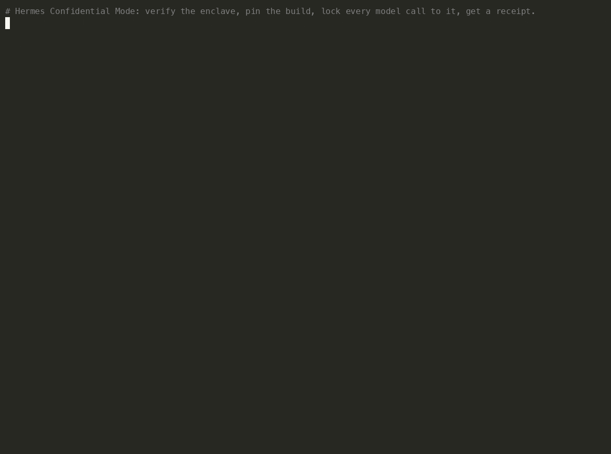
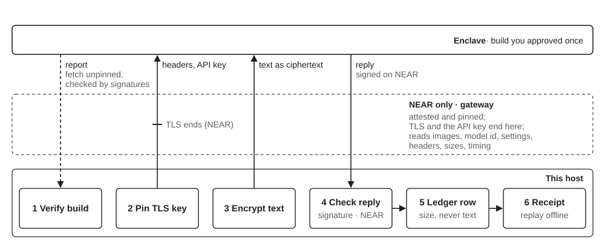
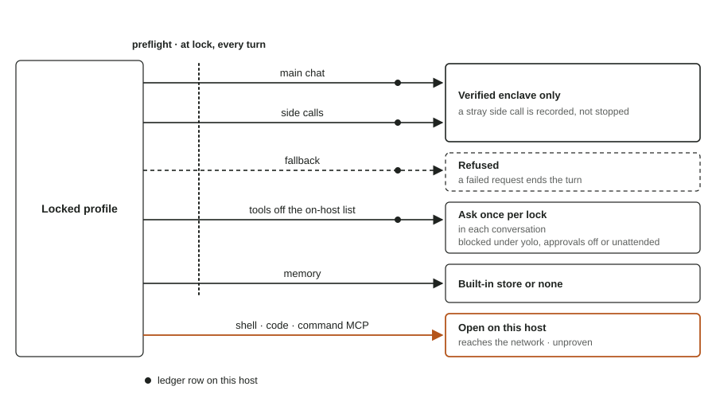

<!-- PLUGIN_NAME: confidential-mode  (final catalog slug; the prose name is Hermes Confidential Mode) -->
# Hermes Confidential Mode

[](https://github.com/ainsleys/hermes-confidential-mode/actions/workflows/tests.yml)



*Lock to a NEAR AI Cloud enclave, one turn, the receipt, its offline replay, unlock. One take, no cuts.*

Hermes cannot verify a confidential-compute provider on its own. Hermes Confidential Mode makes the provider checkable:
it verifies the enclave, pins its build, keeps every model call and fallback inside the enclave, encrypts what
leaves, and writes a receipt anyone can replay.

Install, then watch where every model call goes, locked or not:

```
hermes plugins install https://github.com/ainsleys/hermes-confidential-mode
hermes plugins enable confidential-mode
hermes confidential watch
```

Lock to your own machine with no vendor key (a local model server such as Ollama), or to a verified
enclave with a Tinfoil or NEAR AI Cloud key, then read the session's receipt:

```
hermes confidential on on-host-only     # or: hermes confidential on attested
hermes confidential receipts
```

The [quick start](#quick-start) has the config for each tier. The sections below say what the lock
covers and what the lock cannot cover.

**What Hermes does today.** Point Hermes at Tinfoil or NEAR AI Cloud and you get an ordinary HTTPS
connection to a URL and the vendor's word. Hermes checks no hardware report, pins no build, does not
use the vendor's encrypted transport and verifies no reply signature. Hermes also makes more
model calls than the call you see, for titles, compression, images and more. Those side calls follow
your main provider, but two routes can leave it: an image sent while the vision route is on `auto`,
which Hermes may hand to OpenRouter or Nous if you hold a key for them, and any provider you list under
`fallback_providers`. Tools such as web search pass parts of what you wrote on to outside sites.

**What the plugin does.** You lock a profile to a tier, which is a rule for where text may go.
`attested` allows only enclaves whose hardware report the plugin has verified and whose build you
approved; `on-host-only` allows only your machine. While locked:

- Every model call, main or side, goes only to the tier (a side call that strays mid-turn is recorded,
  not stopped). The plugin checks every configured route before locking and before each turn, and
  refuses main-call fallbacks before any bytes leave.
- The enclave is re-verified whenever its last verification is more than five minutes old, and a
  changed enclave build is refused on every turn until you approve the new build. On both vendors
  every inference connection is pinned to the TLS key of the verified report the plugin accepted,
  inside the handshake and before any byte of the request (headers and API key included) leaves. A
  connection with another certificate is refused and recorded, and triggers a re-verification. The
  attestation fetch itself is not pinned; the plugin verifies the signatures on the attestation the
  fetch returns.
- On the attested tier your text is encrypted to the enclave's key before it leaves your machine:
  Tinfoil through the vendor's encrypted transport, NEAR with every message, tool definition and tool
  call encrypted to the model's key and every reply signed by it. The gateway between you and the
  model cannot read the text. (On NEAR the gateway still sees images, the model id, settings, headers, sizes
  and timing, and a gateway that swapped the reply key would be caught only afterwards.)
- The plugin asks you the first time each tool it does not class as on-host runs during a lock. The
  class follows where the tool's own code sends the tool's data: 25 of Hermes' 73 built-in tools have no
  network path in their own code (skills, memory, todo, clarify, session search, the kanban reads, the
  Desktop panes that read or arrange the app) or are the shell, code and file tools, which run what the
  model writes and are not inspected; those 25 run without a prompt. Every tool that sends data off the
  machine or hands it to another agent asks, and so does every tool whose data flow cannot be settled from
  Hermes' source (docs/TOOL_CLASSES.md). An
  allow lasts until you unlock, in that conversation only, so another chat, user or subagent is
  asked again (`confidential.tools.ask: each_call` asks on every call instead). When nobody can
  answer (yolo, approvals off, cron, one-shot runs), the tool is blocked. Tool servers on
  off-tier remote hosts, scheduled jobs and routed delegation are blocked.
- Every model call is logged with its host and size, never its text, from the moment the plugin is
  enabled. `hermes confidential status` shows the configured route, the live runtime, breaches and
  this lock's refusal, ask and allow counts; `receipts` shows where each call went, and `watch`
  streams the calls live.

**The receipt.** When you want, you render a receipt for the current session or any past one. It is
built from the plugin's ledger: every model call, the lock period, the enclave build that was verified,
and the raw hardware evidence captured at each verification. The receipt comes as readable text or as
JSON that carries the evidence. The enclave's hardware and the vendor sign the evidence, and on NEAR
each reply carries the enclave's signature over the exact bytes, so anyone can re-check the JSON form
offline with `hermes confidential replay`.

**Four limits before you rely on this.** The attested tier admits only models the two vendors serve
inside enclaves; those are open-weight models such as the Qwen, DeepSeek, Llama and gpt-oss families,
so a hosted frontier model cannot be in the tier. Because fallbacks are refused while locked, a vendor
outage ends the turn instead of routing elsewhere. The agent can still run shell commands and code, and the plugin
does not look inside them, so a command such as `curl` could send text anywhere; every receipt says
so. The receipt itself is written by the plugin on your machine, so someone else can trust only
its signed evidence.



*Figure 1. On the attested tier, one model call runs in six steps: the plugin verifies the enclave's
report against the build you approved, pins the connection to the report's TLS key before any byte
leaves (on NEAR the pinned connection ends at the attested gateway), encrypts the text (Tinfoil
encrypts the whole body through the vendor's transport), checks the reply's signature on NEAR before
releasing the reply, writes a ledger row with the size and never the text, and renders a receipt
anyone can replay offline.*



*Figure 2. While a profile is locked, main chat and side calls go only to the verified enclave,
fallback is refused, tools not classed as on-host ask once per lock in each conversation, memory
must be the built-in store or none, and shell, code and command MCP servers stay open on this host.*

## Requirements

- Hermes Agent 0.22.7 or later (`requires_hermes` in `plugin.yaml`). The plugin was built and tested
  against Hermes commit 84a0301.
- macOS or Linux.
- Python as your Hermes install requires; the plugin's dependencies go into Hermes' environment.
- For the `attested` tier, a vendor API key: `TINFOIL_API_KEY` for Tinfoil, or `NEAR_AI_API_KEY` for
  NEAR AI Cloud. Watching the ledger and the `on-host-only` tier need no key.

## Install

```
hermes plugins install https://github.com/ainsleys/hermes-confidential-mode
hermes plugins enable confidential-mode
hermes confidential status | grep '^Plugin:'
```

- **Enable is required.** Without it, every `hermes confidential` command fails with
  "'confidential' is not a hermes command".
- **Enable can take a few minutes.** It downloads `tinfoil`, `pynacl`, `sigstore` and the packages
  they need into Hermes' environment, and meanwhile Hermes prints only "Resolving Python
  dependencies" and "Installing Python dependencies". A quiet terminal doesn't mean the enable step has
  hung. Set `HERMES_VERBOSE=1` to watch the installer.
- **Check which commit is installed.** The last command prints a line such as
  `Plugin: confidential-mode 0.1.0 (commit 3c20cf4a1b2c (git checkout))`, the commit the installed
  copy's `.git` names. Compare that commit with the commit you meant to install. The check does not
  detect local edits.
- **Set your key** in the shell that starts Hermes, or in `<hermes home>/.env`, or give Hermes the key
  through `model.api_key`. The plugin reads keys only through Hermes' secret scope, so a key added only
  with `hermes auth` reads as not set. The lock and `check` refuse while the key is missing. They
  show one of three states, "set", "not set" or "not readable in this scope" (a multiplexed gateway
  with no profile scope), and never show the key itself.
- **Data files.** The plugin keeps the ledger in `<hermes home>/plugin-data/confidential-mode/` and the
  lock, pins and tool grants in `<hermes home>/plugin-data/agent-plugin-confidential-mode-<hash>/`,
  each file mode 0600. `hermes confidential status` prints both paths.
- Leave `plugins.isolation` at its default, `in_process`; under host isolation the lock is refused.
- If you run Hermes from a source checkout with `uv run --no-sync`, the enable step doesn't run, so
  install `pynacl` yourself ([docs/RUNNING_TESTS.md](docs/RUNNING_TESTS.md)).

[Install in detail](docs/GUIDE.md#install-in-detail) covers start-up output, data files and upgrading.

## Quick start

**1. Look at where you are.** Nothing is locked yet; the plugin is only observing.

```
$ hermes confidential status
Confidential mode: not locked (observing only)
…
Preflight: run hermes confidential check --tier <tier>
…
```

`hermes confidential watch` streams each model call's purpose, host and size, locked or not.

**2. Try the plugin without a key.** The `on-host-only` tier needs no vendor key: every model call must stay
on this machine. With a local model server such as Ollama on port 11434, set these keys in
`config.yaml` (replace any `model:` or `auxiliary.vision` you already have), using model names your
server has:

```yaml
model: {provider: custom, base_url: http://127.0.0.1:11434/v1, default: llama3}
auxiliary:
  vision: {provider: custom, base_url: http://127.0.0.1:11434/v1, model: llava}
```

Then lock, have one turn, and read its receipt:

```
$ hermes confidential on on-host-only
Locked to this machine (on-host-only), custom/llama3 at 127.0.0.1.
…
$ hermes                       # ask one question, then, in the chat:
/confidential receipts
```

`hermes confidential off` unlocks. The steps below set up the `attested` tier with Tinfoil.

**3. Verify the vendor and approve the first pin.** Setup verifies the enclave, shows its
fingerprints, asks you to approve them, and prints a config block to merge into `config.yaml`. It
never writes your config.

```
$ hermes confidential setup --vendor tinfoil --model llama3-3-70b
TINFOIL_API_KEY: set
Verified router-0.tinfoil.sh: code 284bd9e5d470c481 enclave … release v0.0.170 (verified_at is the host clock)
…
Next steps:
  1. Merge the block above into config.yaml.
  2. Check: hermes confidential check --tier attested.
  3. Lock: hermes confidential on attested.
```

Setup lists only the steps still to do: setting the key, or approving the pin in a terminal when
setup could not ask you.

For NEAR AI Cloud, use `--vendor near --model Qwen/Qwen3.8-27B`.

**4. Lock.** The preflight checks every route in your config first. If any would leave the tier, the
lock is refused with a table naming each key to change. Once locked, each tool outside the
on-host class asks you the first time that tool runs, on both tiers.

```
$ hermes confidential on attested
Locked to Tinfoil, llama3-3-70b at router-0.tinfoil.sh; verified 4 s ago.
Off-host tools ask the first time per lock in each conversation. Shell and code execution are not inspected. Auxiliary calls are recorded, not refused. Not active in safe-worker mode.
Details: hermes confidential status --verbose; docs/LIMITATIONS.md
```

**5. Have a conversation.** Start `hermes` and ask something that needs the web. The first time each
tool not classed as on-host runs, Hermes' approval panel shows the plugin's line:

```
Confidential mode: web_search wants to send ~1 KB of this conversation off the machine; allowing once covers web_search in this conversation until this profile is unlocked
```

Pick one of four answers:

- **Allow once** runs the tool and covers that tool in this conversation until you unlock, so later
  `web_search` calls in this conversation run without asking; another chat, user or subagent is
  asked again. Each later call still gets a ledger row naming the row that recorded
  your answer. Set `confidential.tools.ask: each_call` to be asked on every call instead.
- **Allow for this session** stops that tool asking until the session ends.
- **Add to permanent allowlist** stops that tool asking across locks, until `/confidential revoke
  <tool>`.
- **Deny** refuses the call.

Under yolo, approvals off, cron jobs and one-shot runs nobody can answer, so the tool is blocked, even
after an Allow once. Hermes titles this panel "Dangerous Command" for every plugin approval, and the
plugin can't change that title.

**6. Read the receipt.** Receipts are rendered on demand, for the current session or any past one. In
the chat, `/confidential receipts` renders the current session; from a terminal, pass any session id:

```
$ hermes confidential receipts <session id>
Confidential mode receipt for session local-c5d92ecacb59…
CHAIN HEAD: dae7c49c3089b27463fe369f7b834e9c0d895ea31cc56cebfbf46cabeefe438d
…
Locked tier: attested  (from lock row)
Provider / model: attested-tinfoil / llama3-3-70b
…
Sends (purpose, host, request and response bytes; never text)
  #17 2026-11-06T15:39:50.138Z (host clock)  aux:title_generation  host=router-0.tinfoil.sh  request 1433 bytes  attested-tinfoil/llama3-3-70b  observed  …
…
What this receipt proves and what it only records. …
```

A full receipt is in [docs/examples/receipt-2026-11-06.txt](docs/examples/receipt-2026-11-06.txt).
Add `--json` for the hash-chained form, and replay its evidence offline with
`hermes confidential replay <receipt.json>`.

## Limits

You're most likely to hit the limits below. [docs/LIMITATIONS.md](docs/LIMITATIONS.md) has the full
list and the change that would close each limit.

- **Shell and code execution aren't inspected.** `terminal`, `execute_code` and `process_manage` run
  on this host while locked, and the plugin does not look inside shell commands or code, so a command
  such as `curl` could send text anywhere. Every receipt names them as unproven.
  ([section 3](docs/LIMITATIONS.md#3-shell-and-code-execution-tools-are-not-inspected))
- **NEAR's gateway sees part of each request.** Image parts reach it in plaintext, and it reads the
  model id, plaintext parameters, headers, sizes and timing. Message text, tool definitions and tool
  calls are encrypted to the verified model key, which every instance of that model shares.
  ([section 14](docs/LIMITATIONS.md#14-near-ai-cloud-what-the-signatures-and-the-evidence-leave-open))
- **The pin prompt asks a human, but an agent with terminal access can reach it.** Some routes, such
  as a nested chat the agent starts, stay open. The ledger records every approval with its surface,
  so treat a pin approved during an agent session as the agent's unless you remember answering.
  ([section 15](docs/LIMITATIONS.md#15-an-agent-with-a-terminal-can-reach-the-approval-prompt))
- **A receipt is a self-report.** It's the plugin's record, from a file on your machine that you or
  another plugin could edit. Only the attached enclave evidence can be checked by someone else.
  ([section 6](docs/LIMITATIONS.md#6-the-trust-boundary-is-the-whole-hermes-process))
- **Tools ask once per lock in each conversation, then run without asking.** The plugin asks you the first time each tool
  not classed as on-host runs during a lock; after Allow once, later calls to that tool in the
  same conversation run until you unlock, each with a ledger row. An answer an agent gave itself
  through a nested chat counts the same way. The grant lives in the process that asked, so a restart
  or a second process asks again. `confidential.tools.ask: each_call` asks on every call.
  ([LIMITATIONS](docs/LIMITATIONS.md), [GUIDE](docs/GUIDE.md))
- **A locked session has no fallback.** If the provider errors, or can't be verified within 20
  seconds, the turn ends and you resend; nothing is rerouted.
  ([docs/LIMITATIONS.md](docs/LIMITATIONS.md), [docs/COSTS.md](docs/COSTS.md))
- **Hermes' own approval prompt grants on any answer except `deny`.** This is a Hermes core issue,
  not one a plugin can fix: the approve path treats no answer, an empty answer, a typo and `yes` alike
  as a grant, and a plugin cannot veto after the prompt. For the tools this plugin gates, the plugin
  runs the tool only when the recorded answer is exactly `once`, `session` or `always`, and refuses
  anything else. Every other tool keeps Hermes' behaviour.
  ([section 2](docs/LIMITATIONS.md#2-the-cli-approve-directive-grants-on-any-answer-except-deny))

A side call that goes off-tier mid-turn (after a runtime model switch, say) is recorded as a breach,
not stopped. Locked mode doesn't apply in Hermes' safe-worker mode, which loads no plugins. If Hermes
runs on someone else's machine, its operator sees every prompt before any of this applies. See the
guide's [threat model](docs/GUIDE.md#threat-model).

## Commands

Every verb works as `hermes confidential <verb>` in a terminal and as `/confidential <verb>` in chat,
except where noted.

| Command | What it does |
|---|---|
| `on <on-host-only\|attested>` | Lock this profile (the preflight runs first). |
| `off` | Unlock, with the lock period's counts. |
| `status [--verbose]` | Lock state, pins, verification, breaches, installed commit; `--verbose` adds the tool list and the preflight. |
| `check [tier] [--verbose]` | The preflight table; with no tier, names the tier `check` picks and why. |
| `setup` | Terminal only: `hermes confidential setup [--vendor near] --model <id>`. |
| `allow <tool>` | Let an off-host tool run without asking, for this lock (asks you). |
| `revoke <tool>`, `revoke --all` | Withdraw the grants confidential mode holds. |
| `pins` | Approved pins, the pending pin, tool grants. |
| `pins review` | Terminal only: builds the review bundle for a pending pin. |
| `pins approve` | Approve the pending pin (asks you). |
| `pins retire <fingerprint>` | Remove one approved entry. |
| `receipts <session> [--json]` | A session receipt. |
| `replay <receipt.json>` | Terminal only: replay a receipt's attestation evidence offline. |
| `watch` | The latest ledger rows (live in a terminal: `hermes confidential watch`). |

## What the plugin touches

The short form of [docs/DISCLOSURE.md](docs/DISCLOSURE.md), which the catalog's rule 13 asks for.

- **Network.** The vendor you configure (atc.tinfoil.sh, the Tinfoil router and the `*.tinfoil.sh`
  collateral proxies, or cloud-api.near.ai), Intel Trust Authority, Sigstore's TUF CDN, and GitHub for
  NEAR's compose files, some of these in background threads. The plugin sends no telemetry.
- **Files.** Writes under `<HERMES_HOME>/plugin-data/` (ledger, evidence, pins, tool grants, state and SDK
  caches), Hermes' tool-discovery cache on a terminal lock, and `config.yaml` on a revoke only, removing
  the plugin's own `command_allowlist` entries through Hermes' `save_config`. Reads `config.yaml` and the
  script files a locked tool call runs.
- **Credentials.** `TINFOIL_API_KEY` and `NEAR_AI_API_KEY` through Hermes' secret scope only; a presence
  check on `OPENROUTER_API_KEY` and `NOUS_API_KEY`. The plugin stores no credential.
- **Processes.** Daemon threads of five kinds (an attestation, a pins match record, a NEAR compose fetch,
  the own-host-name DNS lookup, and one re-verification thread per attested provider while locked). No
  shell command, no subprocess. During a Tinfoil attestation only, the plugin wraps the SDK's fetch
  functions and `requests.Session.request` process-wide and puts the originals back afterwards.
- **Hermes internals.** 31 private core import sites, all in `confidential_mode/hermes_compat.py` and
  listed in [docs/DISCLOSURE.md](docs/DISCLOSURE.md).

## Documentation

- [docs/GUIDE.md](docs/GUIDE.md): the full guide: tiers, NEAR, locking, pins, receipts, replay,
  config, tests.
- [Comparison with earlier approaches](docs/GUIDE.md#comparison-with-earlier-approaches): this plugin
  next to five closed Hermes pull requests.
- [docs/COSTS.md](docs/COSTS.md): what locking costs in latency, quality and task success.
- [docs/LIMITATIONS.md](docs/LIMITATIONS.md): every gap, and the change that would close it.
- [docs/DISCLOSURE.md](docs/DISCLOSURE.md): what the plugin touches on your machine and the network.
- [docs/CLAIMS.md](docs/CLAIMS.md): where each claim is enforced and tested.
- [docs/ADDING_A_VENDOR.md](docs/ADDING_A_VENDOR.md): what a new attested vendor's adapter must provide.
- [docs/ARCHITECTURE.md](docs/ARCHITECTURE.md): every module, what it imports, and the data files.
- [docs/INTERFACES.md](docs/INTERFACES.md): the developer contract: shared types, each module's rules,
  and the file and row formats.
- [CHANGELOG.md](CHANGELOG.md): what each release changes.
- [SECURITY.md](SECURITY.md): how to report a vulnerability, and the threat model in brief.

## Prior work

Five contributors tried to add confidential inference to Hermes core before this plugin. The
maintainers closed four of the pull requests under the policy that provider integrations arrive as
plugins, and closed the first, #7045, as too large for core with a hard Tinfoil dependency; they said
they would revisit enclave inference if users asked for it. Their designs and findings shaped this plugin,
and the guide's
[comparison chapter](docs/GUIDE.md#comparison-with-earlier-approaches) sets each against what the
plugin does now.

- [#7045](https://github.com/NousResearch/hermes-agent/pull/7045) by aljazceru, April 2026: a Tinfoil
  provider with a fail-closed design that this plugin keeps.
- [#4231](https://github.com/NousResearch/hermes-agent/pull/4231) by elkimek, July 2026: Venice's
  encrypted models, with client-side request encryption.
- [#5015](https://github.com/NousResearch/hermes-agent/pull/5015) by Alex4Xu, July 2026: RedPill as a
  provider.
- [#12201](https://github.com/NousResearch/hermes-agent/pull/12201) by amiller, July 2026: NEAR AI and
  Phala with TDX attestation and end-to-end encryption, the most complete of the five and the basis
  for this plugin's NEAR checks. The same author maintains a
  [public registry of TEE-verified inference providers](https://github.com/amiller/awesome-private-inference).
- [#31613](https://github.com/NousResearch/hermes-agent/pull/31613) by KellenRenshaw, July 2026: a
  Tinfoil provider and encrypted transport.

## Status

Experimental. Built for the Nous Research Hermes plugin hackathon, November 2026.

Support: open an issue at https://github.com/ainsleys/hermes-confidential-mode/issues.
